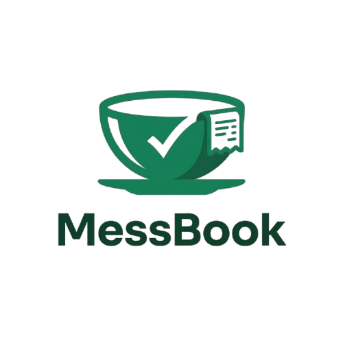
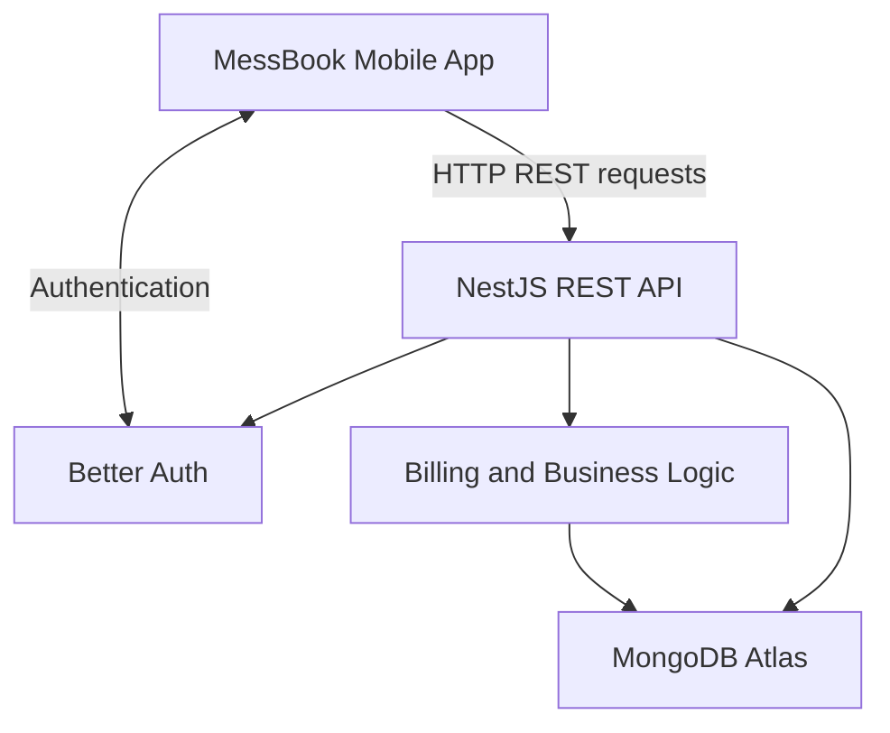

# MessBook

  

  <strong>Simple, reliable mess management and billing for India.</strong>

  Manage customers, menus, daily meals, bills, and payments — all in one mobile application.

  
  
  
  
  

---

## Overview

**MessBook** is a mobile-first mess management and billing application designed for Indian mess owners who want to simplify everyday operations without relying on scattered notebooks, manual calculations, and separate records.

From managing customers and menu items to recording daily meals, generating bills, and tracking payments, MessBook brings essential mess operations into one place.

The project follows a client-server architecture: the mobile application communicates with a dedicated REST API, while the backend handles business logic, authentication, billing calculations, and database operations.

## Features

- **Customer management** — Add customers, update their details, search records, and manage active customers.
- **Menu management** — Maintain menu items, prices, and item categories.
- **Daily meal recording** — Record meals for customers and preserve item prices at the time of recording.
- **Flexible billing** — Support pay-per-meal, weekly, and monthly billing according to configured customer billing arrangements.
- **Bill history and details** — View generated bills and their associated billing information.
- **Payment tracking** — Track paid and pending bills and manage payment status.
- **Dashboard overview** — Get a daily overview of mess operations and pending payments.
- **Server-side billing** — Calculate bill amounts on the backend rather than trusting prices or totals submitted by the mobile client.
- **Duplicate-billing safeguards** — Apply billing-period checks and meal-to-bill associations to help prevent the same meals or billing periods from being charged twice.

The goal is to keep routine operations straightforward for mess owners while maintaining reliable billing records.

## Tech Stack

| Layer | Technology |
|---|---|
| Mobile application | Expo, React Native |
| Language | TypeScript |
| Navigation | Expo Router |
| Styling | NativeWind |
| Backend API | NestJS |
| Database | MongoDB Atlas |
| Database integration | Mongoose |
| Authentication | Better Auth |
| Request validation | class-validator |

### Architecture

The mobile application is responsible for the user interface and communicating with the API. The backend owns database access and business rules.

**Database access is kept on the server.** The Expo application does not connect directly to MongoDB or contain the backend's database models and business API implementation.

## Billing Rules

Billing accuracy is central to MessBook. The server applies billing rules based on the customer's configured billing arrangement.

| Billing type | Billing calculation |
|---|---|
| Pay per meal | Includes unbilled meal records in the requested range, grouped by item and price |
| Weekly | Plan amount plus applicable items categorized as `EXTRA`, for Monday–Sunday billing periods in Indian Standard Time |
| Monthly | Plan amount plus applicable items categorized as `EXTRA`, for calendar-month billing periods in Indian Standard Time |

### Billing integrity

- **Historical prices are preserved.** Meal records store the item name and price at the time the meal is recorded.
- **The server calculates bills.** Prices are read from the server's menu and billing data; the client cannot supply arbitrary prices to determine the bill total.
- **Billed meals are associated with their bill.** Once included in a bill, a meal is excluded from future unbilled-meal calculations and cannot be deleted through the normal meal-recording workflow.
- **Billing periods are protected against duplication.** Weekly and monthly billing periods are checked so an already-billed period cannot simply be billed again.
- **Bill history remains meaningful.** Subsequent menu-price changes should not silently change historical meal records.

These safeguards help maintain consistent billing records and reduce accidental duplicate charges.

  <strong>MessBook</strong> 
  Making everyday mess management simpler, one bill at a time.

